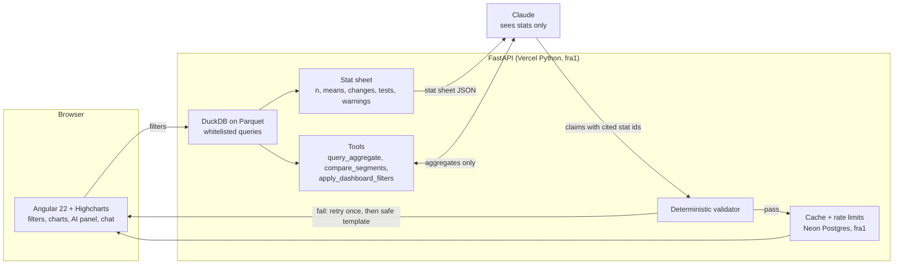

# Quorra Insights: survey analytics that never makes up numbers

A working demo of AI interpretations, conversational analytics and application summaries on top of an Angular + Highcharts survey dashboard. Every figure the AI writes is checked by deterministic code before anyone sees it.

**Live demo:** https://grounded-analytics-demo.vercel.app · [Eval results](https://grounded-analytics-demo.vercel.app/eval) · [What leaves the server](https://grounded-analytics-demo.vercel.app/data-flow)

Quorra Insights is a fictional brand. All data is synthetic, no real people are involved.

## What it proves

- **An LLM can explain survey data without being trusted with the numbers.** The server computes the statistics. The model only writes about them, and every claim must cite the stats it uses.
- **Wrong figures are caught by code, not by another model.** A deterministic validator checks each number against the cited stat. If it fails, the model gets one retry, then a safe template replaces the text.
- **Chat cannot invent data.** The model has three whitelisted tools and no SQL. A question the data can't answer gets a clear refusal.
- **It stops when the data is too thin.** Below 30 responses there is no AI text at all.
- **Raw responses stay on the server.** The model receives aggregates only.

## Eval results

<!-- eval:start -->
_Eval results are generated by `scripts/update_readme_eval.py`._
<!-- eval:end -->

The [/eval page](https://grounded-analytics-demo.vercel.app/eval) shows every question with both answers. It renders from [`eval/results.json`](eval/results.json), and a Playwright test checks the page against that file.

## Architecture



| Layer | Stack |
|---|---|
| Frontend | Angular 22, standalone components, signals, zoneless, Highcharts 13 |
| Backend | Python 3.13, FastAPI, DuckDB, SciPy, deployed as Vercel Python functions in Frankfurt |
| Data | About 3,000 synthetic responses over 6 quarters in Parquet |
| LLM | Claude Opus 5.5 through the Anthropic API, server side only |
| State | Neon Postgres (Frankfurt) for cache and rate limits |

## How grounding and validation work

**1. Compute first.** For the current filters, the server builds a stat sheet: n, means, agreement shares, NPS, change against the previous period, segment gaps, comment theme shares and warnings. Each stat has an id such as `S16`.

Tests used:

| Comparison | Test |
|---|---|
| Mean, two groups or periods | Welch's t-test, Cohen's d |
| Mean across segments | One-way ANOVA, eta squared |
| Answer distribution, agreement shares | Chi-square |
| NPS, two groups or periods | Two-sample z-test on the coded score |
| Families of tests on the stat sheet | Benjamini-Hochberg adjustment |

**2. The model writes claims, not numbers it found.** It gets the stat sheet and returns structured output: a summary and findings, each with `cites: ["S16", "S21"]`.

**3. The validator checks every claim** in [`grounded/validator.py`](grounded/validator.py). No model is involved, so the same input always gets the same verdict.

| Check | Example it rejects |
|---|---|
| Every claim cites a real stat | A sentence with no citation, or `S99` |
| Every number matches a cited stat | "3.95" when the stat says 3.85 |
| Rounding rules | "3.8" for 3.85 (it rounds to 3.9), "3.851" (false precision), "4" for a mean, "about 1,200" for a count of 1,234 |
| Units and signs | "3.85%" for a scale mean, "+0.14" for a fall of 0.14 |
| German and English number formats | "3.85" in German text |
| Digits only | "about half", "doubled", "zwei Drittel" |
| Periods exist | "Q1 2024" |
| Direction | "rose" when the cited change is negative |
| Significance | "significant" when the cited test was not |
| Named segments | "in the North" with no cited stat about the North |
| No causal claims | "because", "driven by", "aufgrund" |

**4. Failure is visible and safe.** A failed answer is regenerated once with the validator's feedback. If that fails too, the panel says the AI text was withheld and shows a template filled from the stats. The UI marks all AI output and shows how many figures were verified.

**5. Small samples.** Under 30 responses: no model call, the panel says there isn't enough data. Segments under 30 are left out of comparisons. Cells under 5 are hidden from the API.

**Limit of the guarantee.** The validator proves that figures, citations, directions and named segments are right. It can't prove that a correct sentence is the most useful thing to say, or catch every misleading emphasis. Those stay a human judgement, which is why the cited stats are one click away.

## Conversational analytics

The chat model has no data and writes no SQL. It can call:

- `query_aggregate`: a whitelisted measure, optional grouping, whitelisted filters
- `compare_segments`: a tested difference between two segments or periods
- `apply_dashboard_filters`: changes the dashboard, as in "show me only the North region in 2026"

Tool arguments are validated again on the server, because a schema sent to a model is not a security boundary. Slices under 30 return no value. Answers go through the same validator and can cite only stats returned in the same turn.

## Application summaries

Five synthetic grant applications. Each statement lists the fields it came from, and its numbers must appear in those fields. Rules catch missing fields and arithmetic conflicts between fields, and the model adds conflicts between free text and fields, naming at least two fields. Nothing is filled in. If validation fails, the reviewer sees the rule-based flags and the submitted fields only.

## Privacy: what leaves the server

| Feature | Sent to the model | Never sent |
|---|---|---|
| AI interpretation | Stat sheet: labels, n, means, shares, changes, test results, comment themes as counts with hashed reference ids | Rows, response ids, comment text |
| Chat | Question, current filters, up to 6 earlier chat turns, aggregate tool results | Rows, response ids, comment text |
| Application summaries | Fields and free text, with emails and phone numbers scrubbed | Contact name, contact email |
| Charts | Nothing | Everything |

Raw comment text is in a separate file that isn't deployed with the API. Themes are assigned offline. Visitor addresses are stored only as salted hashes for rate limiting. A pytest case checks that model input contains no comment text, response ids or names. The panel's "What the model received" section shows the exact payload.

Applications are the one place free text goes to the model, because summarising it is the feature. In production that needs its own legal basis and a data processing agreement.

## Cost controls on the public demo

- Results are cached by a hash of the filters, language, model, prompt version and dataset
- Common filter states are generated in advance and committed, so they cost nothing to view
- Each visitor gets 30 model-backed requests per hour, and the site gets 250 per day
- When a limit is reached, the panel shows computed figures only
- Question length, chat history and tool rounds are capped

## EU hosting options for production

This demo calls the Anthropic API directly, which does not offer EU-only processing. Production needs one of the routes below. Checked against vendor documentation on 2026-11-06. These offerings change often, so confirm them again before signing.

| Option | What the vendor documents | Worth knowing |
|---|---|---|
| **Claude on Amazon Bedrock**, EU geo profile | `eu.anthropic.claude-*` profiles for Opus 5.5, Sonnet 5.5, Haiku 5.5, Opus 5 and Sonnet 5. From Frankfurt they route to Frankfurt, Stockholm, Milan, Spain, Ireland and Paris | Frankfurt is not a single-region option. Calling from London or Zurich adds a non-EU destination. Confirm routing with `GetInferenceProfile` |
| **Claude on Google Cloud**, `eu` multi-region | Haiku, Sonnet and Opus 5.5, Sonnet and Opus 5, Fable 5 and 5.1, among others. Excludes the UK and Switzerland | Use the `eu` endpoint: the global endpoint does not support data residency. Single-region EU (`europe-west1`) has only older models |
| **Mistral**, `api.eu.mistral.ai` | EU and EFTA data centres at 1.1x price, function calling supported | No Agents, Batch or Files on this endpoint. The control plane may sit outside the region |
| **Azure OpenAI**, Data Zone Standard (EU) | GPT models, Germany West Central included | Microsoft's pages differ on whether the zone can include non-EU countries, and regions can be added without notice |
| **IONOS AI Model Hub** | Data centres in Germany, content not logged or used for training. Llama 3.3 70B, GPT-OSS 120B, Mistral Small 24B, Qwen3.5 397B | Open models, so re-run the eval before choosing one |
| **STACKIT AI Model Serving** | Qwen, Llama 3.3 70B, GPT-OSS, Gemma on `eu01` | The pages read did not name the country, so ask STACKIT |
| **Aleph Alpha PhariaAI** | Self-hosted through Helm and Kubernetes | Installation guide found, no hosted API confirmed |

Not EU options today: the Anthropic API `inference_geo` setting offers only `global` and `us`, and Claude on Microsoft Foundry lists Global Standard and US Data Zone only.

Moving is small here because only [`grounded/llm.py`](grounded/llm.py) talks to the provider. The Anthropic SDK has clients for Bedrock and Vertex with the same message format. After any switch, run `eval.run_eval` again, since the score belongs to a model and a prompt together.

Sources: [Bedrock Opus 5.5 model card](https://docs.aws.amazon.com/bedrock/latest/userguide/model-card-anthropic-claude-opus-5-5.html), [Bedrock geographic inference](https://docs.aws.amazon.com/bedrock/latest/userguide/geographic-cross-region-inference.html), [Google Cloud locations](https://docs.cloud.google.com/gemini-enterprise-agent-platform/resources/locations), [Google Cloud data residency](https://docs.cloud.google.com/gemini-enterprise-agent-platform/resources/data-residency), [Claude data residency](https://platform.claude.com/docs/en/manage-claude/data-residency), [Claude on Foundry](https://learn.microsoft.com/en-us/azure/foundry/foundry-models/concepts/claude-models-hosting-comparison), [Mistral regional inference](https://docs.mistral.ai/inference/regional-inference), [Azure regions](https://learn.microsoft.com/en-us/azure/foundry/foundry-models/concepts/models-sold-directly-by-azure-region-availability), [Azure deployment types](https://learn.microsoft.com/en-us/azure/foundry/foundry-models/concepts/deployment-types), [IONOS data handling](https://docs.ionos.com/cloud/ai/ai-model-hub/governance-and-compliance/data-handling), [IONOS models](https://docs.ionos.com/cloud/ai/ai-model-hub/models/models-comparison), [STACKIT models](https://docs.stackit.cloud/products/data-and-ai/ai-model-serving/basics/available-shared-models/), [PhariaAI](https://docs.aleph-alpha.com/phariaai-install-config-guide/latest/index.html).

## Plugging this into an existing Angular app

The AI layer sits beside your dashboard. It does not replace it.

1. **Backend.** Replace [`grounded/data.py`](grounded/data.py) with queries on your own store, and [`grounded/catalog.py`](grounded/catalog.py) with your questions and dimensions. The stats, validator, prompts and tools stay as they are.
2. **Angular.** Copy `DashboardStore` and `AiPanel`. Call `store.setFilters()` from your existing filter state. If you already have an NgRx store or a service, feed its filter stream in. The panel is one standalone component with no routing needs.
3. **Highcharts.** Your charts stay. To get click-to-highlight, read `store.highlights()`, a list of `{chart, series, categories}` built from the cited stats, and apply it to your chart instances, as [`options.ts`](frontend/src/app/charts/options.ts) does.
4. **Auth.** Put the API behind your existing session, and scope every query by tenant in `data.py`. Key the cache by tenant as well.

The contract is four endpoints: `POST /api/dashboard`, `POST /api/interpret`, `POST /api/chat` and `POST /api/applications/{id}/summary`.

## Highcharts licence

Highcharts is free for personal, non-commercial use and for education at accredited institutions. Commercial use needs a paid licence, and a SaaS product needs the SaaS licence. See the [licence page](https://shop.highcharts.com/license). That decision is the client's.

## Run it

```bash
uv venv --python 3.13 .venv && uv pip install -r requirements-dev.txt
npm ci --prefix frontend && npm run build --prefix frontend

# Mock model, no key needed
LLM_MODE=mock .venv/bin/python -m scripts.serve_built     # http://127.0.0.1:4300

# Real model: put ANTHROPIC_API_KEY in .env.local
.venv/bin/python -m scripts.serve_built
```

| Command | What it does |
|---|---|
| `.venv/bin/python -m pytest` | Stats, validator, tools, refusals, privacy, eval scorer |
| `npm test --prefix frontend` | Angular unit tests |
| `npm run e2e --prefix frontend` | Playwright, against the mock model |
| `.venv/bin/python -m eval.run_eval` | Real model runs, rewrites `eval/results.json` |
| `.venv/bin/python -m scripts.prewarm` | Regenerates the committed cached results |
| `.venv/bin/python -m scripts.update_readme_eval` | Refreshes the eval table above |

CI runs lint, all three test suites and a gitleaks scan on every push. Tests use a mock model, so CI needs no API key.

---

Demo by [DC Tech](https://dctechltd.com)
